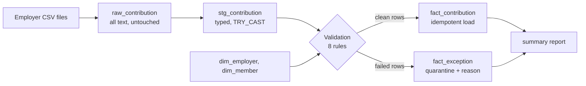

# Contribution Reconciliation Pipeline


A small data engineering project that ingests monthly employer contribution files, validates them against member records, quarantines bad rows with a reason, and loads clean rows into a warehouse with an idempotent load. It uses **synthetic pension-style data only**, because real pension data is sensitive.

## The problem

Employers send periodic contribution files. Before the data can be trusted, someone has to answer: are there duplicates, unknown members, wrong amounts, late submissions? Do the loaded rows reconcile with what was received? This project is a one-command version of that workflow.

## Architecture



| Layer | Table | Purpose |
|---|---|---|
| Raw | `raw_contribution` | Exactly what was received, as text, with file and row lineage |
| Staging | `stg_contribution` | Typed columns; unparseable values become NULL instead of crashing the load |
| Warehouse | `fact_contribution`, `dim_member`, `dim_employer` | Clean, trusted data |
| Quarantine | `fact_exception` | Every rejected row with file, row number, rule, and details |

## Validation rules

| Rule | Check |
|---|---|
| `MALFORMED_FIELD` | Empty or unparseable date or amount |
| `DUPLICATE_ROW` | Same member and period already seen |
| `UNKNOWN_MEMBER` | `member_id` not in `dim_member` |
| `EMPLOYER_MISMATCH` | Row's employer differs from the member's employer |
| `LEFT_MEMBER` | Contribution for a member who has left |
| `INVALID_AMOUNT` | Zero or negative amount |
| `ABOVE_LIMIT` | Total contribution above 30% of monthly salary |
| `LATE_SUBMISSION` | Received after the employer's due day (flagged, but still loaded) |

Rules are entries in one dictionary in `src/validate.py`, so adding a rule is one entry.

## Results (synthetic run, 5 employers, 500 members)

| Metric | Value |
|---|---|
| Rows staged | 481 |
| Rows loaded | 448 |
| Rows quarantined | 33 |
| Late rows (loaded but flagged) | 3 |
| Reconciliation (staged = loaded + quarantined) | OK |
| Injected errors | 36 |
| Detection recall / precision | 36/36 (100%) / 36/36 (100%) |

The generator injects labelled errors and writes an answer key, so detection is measured, not assumed. The pipeline summary is written to `reports/summary.md` on every run.

## How to run

**With Docker (one command):**
```bash
docker compose up --build
```

**Locally:**
```bash
python -m venv .venv
.venv\Scripts\activate        # macOS/Linux: source .venv/bin/activate
python -m pip install -r requirements.txt
python src/run_pipeline.py    # generate -> ingest -> validate -> load -> report
python -m pytest -v           # data quality tests
```

## Design decisions

- **Raw layer kept untouched.** Reprocessing and audit never depend on a cleaned copy.
- **Quarantine instead of dropping.** Every rejected row is traceable to a file, row, and rule.
- **Idempotent load.** `INSERT OR REPLACE` on the `(member_id, period_month)` primary key means reruns and retries do not create duplicates. A test checks this.
- **Late is not invalid.** A late contribution is still a real contribution, so it loads and is flagged rather than quarantined.
- **Retries with backoff and logging.** `src/run_pipeline.py` retries each step up to three times and logs step, attempt, timing, and outcome to `logs/pipeline.log`.
- **Tests check the output, not the rules.** The pytest suite checks the loaded table independently (no duplicate keys, no nulls, no unknown or departed members, amounts within limits, reconciliation, idempotence), so a broken rule would be caught.
- **CI.** GitHub Actions runs the test suite on every push.

## Project structure

```
data/sample/       one example input file
sql/schema.sql     warehouse tables
src/               generate, ingest, validate, load, report, run_pipeline
tests/             data quality tests
dags/              Airflow DAG definition
reports/           latest run summary
```

## Limitations

- **The 100% detection figure is for injected errors that match the rules I wrote.** It shows the rules work as designed, not that they would catch every real-world problem.
- Data is synthetic, and the 30% contribution limit is an assumed threshold, not a statutory rule.
- One contribution period (2026-09) is hard-coded; there is no incremental or multi-period handling yet.
- A file-level `TOTAL_MISMATCH` check (footer total vs row sum) is not implemented.
- The Airflow DAG (`dags/`) is provided as a definition but has not been run in this repo; scheduling is exercised through the Python runner.
- DuckDB is single-node; a production system would use a server warehouse and a real file-arrival trigger.

## Possible extensions

Multi-period incremental loads, handling corrected file resubmissions, an Isolation Forest check for unusual amounts that rules miss, and running the DAG in Airflow under Docker.